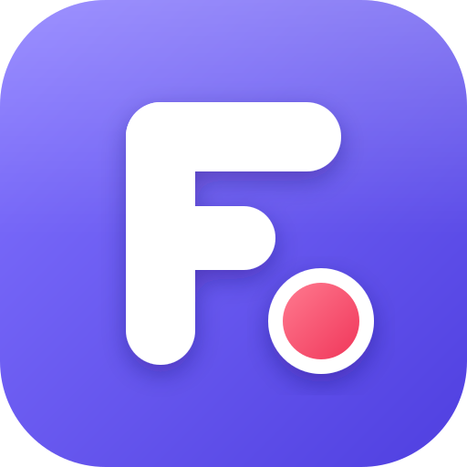
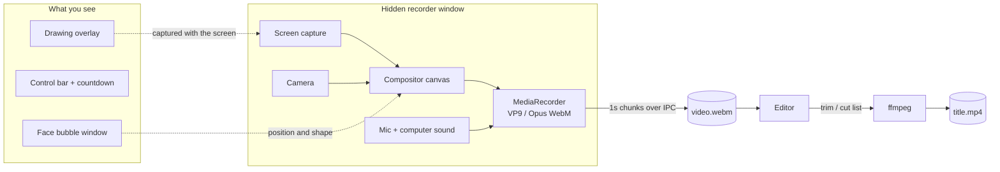

<p align="center">
  
</p>

<h1 align="center">Froom</h1>

<p align="center">
  <b>Record your screen with your face in a bubble, cut the dead air, and save an MP4.</b><br>
  A free, local-only Loom alternative for Windows.
</p>

<p align="center">
  <a href="https://github.com/abel123code/froom/releases/latest"><b>⬇ Download for Windows</b></a>
</p>

---

## Why Froom

- **Your face in a bubble.** A round camera bubble floats over your screen, and it's in the video exactly where you leave it.
- **No clutter in the video.** The control bar, countdown and bubble window are hidden from the capture, so the video shows only your screen and face.
- **Cut dead space in one click.** **Remove silences** finds the pauses and cuts them for you.
- **Draw while you talk.** Arrows, lines and circles that fade on their own, plus a ring wherever you click.
- **100% local.** No account, no upload, no cloud. Videos are saved in your `Videos\Froom` folder.

## Install

1. Download **Froom-Setup-x.y.z.exe** from the [latest release](https://github.com/abel123code/froom/releases/latest).
2. Run it. Windows may show "Windows protected your PC" because the app isn't code-signed. Click **More info → Run anyway**.
3. Open **Froom** from the Start menu or the desktop shortcut.

The first time you record, Windows asks for camera and microphone access. Allow both.

## Walkthrough

### 1. Start a recording

Click **Record a video** (or **New video**) and choose:

| Mode | What you get |
| --- | --- |
| **Screen + Cam** | Your screen with your face in a bubble |
| **Screen only** | Just your screen |
| **Cam only** | Full-frame camera, like a video message |

Then pick the screen or a single window, your camera and your mic. A live level bar shows that the mic is working. Turn on **Computer sound** to also record audio playing on your PC, like a video or a call.

### 2. Record

Press **Start recording**. A **3-2-1** countdown appears in the middle of the screen, then recording starts.

- **Face bubble:** drag it anywhere. Hover over it to change the size (S / M / L) or shape.
- **Control bar:** stop, pause/resume, restart, delete, camera on/off, the timer and the pen. It never shows up in the video.
- **Draw on screen:** click the pen (or press **Alt+Shift+D**), then choose **pen**, **arrow** or **circle** and a colour. Each mark stays for 4 seconds, then fades. Press **Esc** to go back to using your mouse normally.
- **Click highlights:** a yellow ring pops wherever you click. You can switch it off in the recorder panel.

> Drawing and click rings work when you record the **entire screen**.

| Shortcut | Action |
| --- | --- |
| `Alt+Shift+L` | Stop recording |
| `Alt+Shift+P` | Pause / resume |
| `Alt+Shift+D` | Toggle drawing |

### 3. Edit

When you stop, the editor opens with a timeline that shows video frames above the audio waveform.

- **Trim:** drag the purple handles at either end of the timeline.
- **Cut a part:** drag across the timeline to select it, then click **Cut** (or press **Delete**).
- **Remove silences:** set the **Minimum pause** and **Sensitivity**, then click **Remove silences**. Every quiet stretch is marked as a cut, so you can review it before saving.
- **Change your mind:** click a cut part to **Restore** it, or press **Ctrl+Z** to undo.
- **Preview:** playback skips the cut parts, so you hear the final result.

The **Final length** card updates as you edit.

### 4. Save

Click **Download MP4**. Froom saves `Videos\Froom\<title>.mp4`, an H.264/AAC file that plays everywhere and uploads anywhere. Click **Show file** to open the folder.

Your original recording is never changed. You can come back from **My library** to re-edit and export again.

## How it works

Froom is an [Electron](https://www.electronjs.org/) app built with React and TypeScript. It uses [ffmpeg](https://ffmpeg.org/) for all the video processing.



### Recording

- **Screen capture:** Electron's `desktopCapturer` lists your screens and windows. The one you pick is fed to `getDisplayMedia`, with Windows loopback audio for computer sound.
- **Keeping UI out of the video:** the bubble, control bar and countdown windows use `setContentProtection(true)`. Windows then removes them from any screen capture, including Froom's own.
- **Baking in the face:** because the bubble window is hidden from capture, a hidden recorder window draws your face into each video frame itself. It reads the screen and camera frame by frame (`MediaStreamTrackProcessor`), paints them onto an `OffscreenCanvas` at the bubble's current position, size and shape, and records the result. This works the same for full screen and single-window recordings.
- **Streaming to disk:** `MediaRecorder` sends a chunk every second, and the chunks are written to disk in order as they arrive, so long recordings don't pile up in memory. When you stop, ffmpeg remuxes the file so the length and seeking are correct.

### Drawing and click highlights

- Drawing happens on a transparent full-screen window. Unlike the control bar, it is **not** hidden from capture, so your marks land in the video naturally.
- Mouse clicks pass straight through it to your apps. In drawing mode it starts catching the mouse instead.
- Clicks are detected system-wide with [`uiohook-napi`](https://github.com/SnosMe/uiohook-napi) and drawn as fading rings at the click point.

### Editing

- An edit is a small list: `{ trimStart, trimEnd, cuts[] }`. The original file is never changed.
- **Remove silences** runs ffmpeg's `silencedetect` with your threshold and minimum pause, and turns each silent stretch into a cut.
- The waveform is drawn from raw audio samples, and the frame strip is a single image of 16 frames taken by ffmpeg.
- **Export** turns the parts you kept into an ffmpeg `trim` / `atrim` + `concat` filter and encodes it to H.264/AAC. Cuts are frame-accurate and audio stays in sync.

### Where things are stored

```
Videos\Froom\
├── My video.mp4             ← exported videos
└── .recordings\<id>\
    ├── video.webm           ← original recording
    ├── meta.json            ← title, duration, your edits
    ├── thumb.jpg            ← library thumbnail
    ├── frames.jpg           ← timeline frame strip
    └── peaks.json           ← waveform
```

### Project layout

```
src/
├── main/            Electron main process
│   ├── index.ts       windows, capture, hotkeys, click hook, IPC
│   ├── ffmpeg.ts      remux, thumbnails, waveform, silence detection, export
│   └── library.ts     recordings folder and metadata
├── preload/         safe bridge between main and the UI (window.api)
├── renderer/src/    React UI
│   ├── recorder.ts    compositor and MediaRecorder
│   ├── views/         Home, Editor, Bubble, Controls, Countdown, Overlay
│   └── components/    RecorderPanel, Timeline, Modal, Logo
└── shared/          types and edit math shared by both sides
```

## Build from source

You need [Node.js](https://nodejs.org/) 20 or newer and Windows 10 or 11.

```bash
git clone https://github.com/abel123code/froom.git
cd froom
npm install
npm run dev          # run with hot reload
npm run build:win    # build the installer into dist/
```

If `npm run dev` says `Electron uninstall`, run `node node_modules/electron/install.js` once.

## Limitations

- **Windows only for now.** Hiding the controls from the recording relies on a Windows capture feature.
- Drawing and click highlights only work when recording the entire screen.
- Recordings are capped at 1080p to keep things smooth.
- There's no sharing link. You get an MP4 file to send or upload wherever you like.
